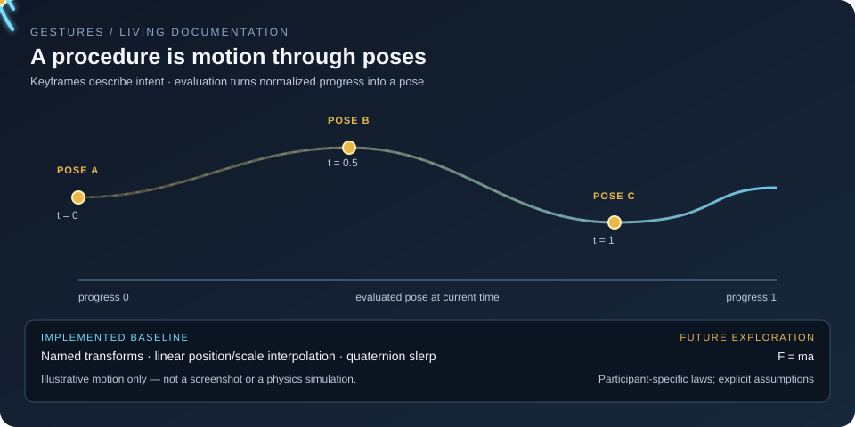
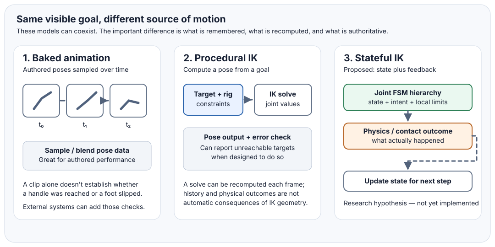
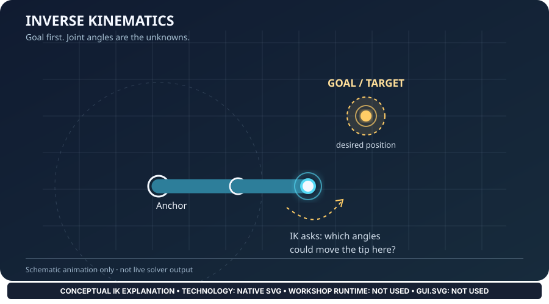
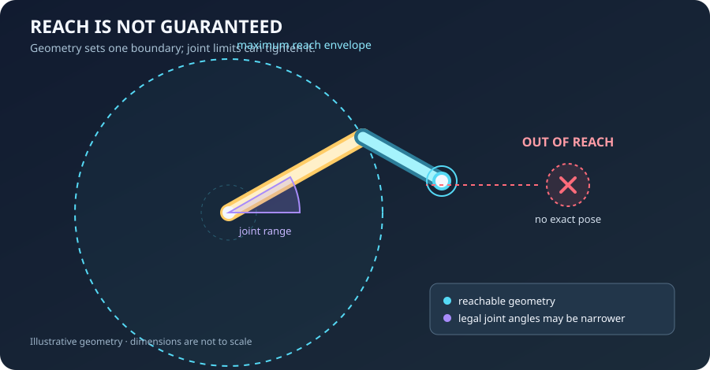
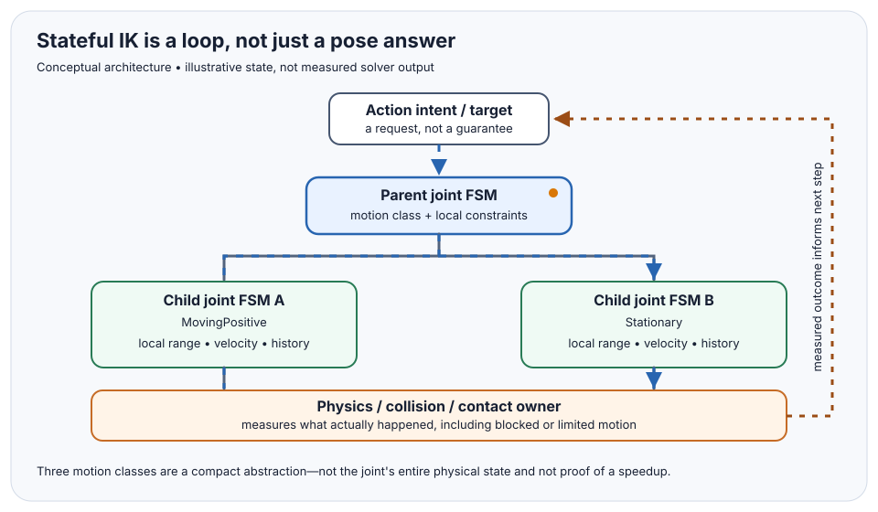
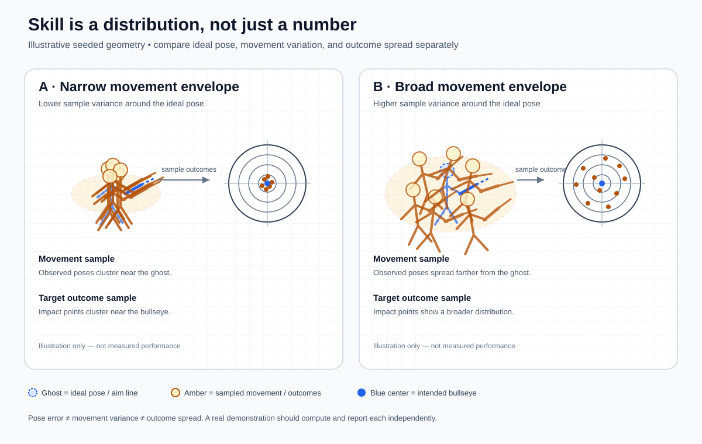

# ✳️ 00 The Singularity Workshop — Gestures

[](https://github.com/TrentBest/TheSingularityWorkshop.Gestures/actions/workflows/build.yml)
[](https://codecov.io/gh/TrentBest/TheSingularityWorkshop.Gestures/branch/development)
[](LICENSE)


**Procedural physical action, represented as data and evaluated deterministically.**

TheSingularityWorkshop.Gestures is the reusable model and CPU reference evaluator for physical procedures: pose keyframes, interpolation, progression, stable individual variation, and evaluated pose output. It lets a capability describe how an interaction physically happens without requiring every consumer to author a conventional baked animation clip.

> **Status: early alpha foundation with research prototypes.** The deterministic CPU evaluator remains the small reference contract; it is not a complete animation system, physics solver, or GPU evaluator. Additional research prototypes now cover planar kinematics, speed-limited hinges, stateful joint hierarchies, contact observations and recovery policy, movement-course evaluation, and a generated skill-distribution SVG demo. These are test-backed experiments, not a claim of a production-ready IK or physical contact solver. This repository does not publish to NuGet.

## 🟦 01 What


A Gesture is more than a list of poses. It describes a physical procedure whose progress can be evaluated at a given time, with optional deterministic variation bounded around ideal motion.

Examples include a soldier entering a vehicle cockpit using anchors supplied by the vehicle, climbing through a hatch, operating a mechanism, or coordinated marching where individuals share an ideal procedure without moving as perfect copies.

## 🟣 02 Why


Baked animation clips can be useful, but they often encode a finished performance rather than a reusable procedure that can adapt to identity, context, and a desired level of variation. Gestures aims to make the procedure and its transition rules reusable data.

The ideal Gesture establishes the intended action. Each entity's stable seed and experience/context profile influence bounded parameters of the motion itself. Green soldiers can have broader variation ranges; veterans can have tighter ranges while remaining individually distinct. The goal is coherent variation, not per-frame random noise. The current experience-profile sampler only bounds the evaluator's speed and root lateral-offset channels; it does not yet model joint-level competence or per-joint skill. The scalar spring-damper is a separate, timestep-sensitive research primitive and is not integrated into `GestureEvaluator`.

Crowd-flow contracts describe experience-authored entrances/exits and four common traversal intents; see [Crowd Flow Reference](docs/CROWD_FLOW_REFERENCE.md). This is a validated configuration contract, not yet a crowd solver.

## 🔺 03 How


```text
Capability / Gesture Provider
           | defines physical procedure
           v
    GestureDefinition -- anchors + keyframes
           |
           v
 CPU reference evaluator -- stable identity + bounded variation
           |
           v
     EvaluatedPose -------- disposable presentation input
           |
           v
 Renderer selects fidelity -> Visualize executes GPU presentation
```

Each part has a clear owner:

- **Gestures** owns Gesture data, anchors, deterministic reference evaluation, and evaluated pose output.
- **FSM_API** may govern progression, interruption, and completion in a consumer; Gestures does not require it as a dependency.
- **Gesture Provider / MicroBundle** supplies domain-specific physical procedure and interaction anchors.
- **Renderer** chooses observer-relative representation and fidelity.
- **Visualize** performs GPU-facing presentation.
- **raWWar** supplies domain capabilities and authoritative game state.

The package intentionally has no dependency on WPF, Unity, Renderer, a GPU API, or game-specific types. The initial evaluator linearly interpolates translation and scale and uses quaternion spherical interpolation for rotation. This is a reference baseline, not a final high-fidelity motion solver.

## 🟢 04 See it in a minute




This scene is generated by [the C# demonstration](tools/living-demo/Program.cs), not drawn as an independent animation. **FSM_API** moves the demonstration through `Ready → Running → Complete`; `GestureEvaluator` evaluates one real `GestureDefinition` at 49 elapsed-time samples; the SVG path is serialized from those returned `EvaluatedPose` positions; the marker’s heading and size are driven by the evaluated quaternion rotation and scale. The straight segments are intentional: the current evaluator uses linear position interpolation. The browser plays sampled SVG values; it does not execute C# or run FSM_API at display time. The build workflow regenerates all three current SVGs, validates their XML, and uploads the exact output as a workflow artifact; the checked-in images remain reviewable documentation snapshots. [See how to regenerate the scene](tools/living-demo/README.md). This shows the current evaluator honestly—it is not a rig hierarchy, IK solver, or physics simulation. The [Living Motion Documentation standard](docs/LIVING_MOTION_DOCUMENTATION.md) also catalogs the companion [motion-channel plots](docs/assets/gesture-channels.svg) and [target-agnostic motion illustration](docs/assets/gesture-target-agnostic.svg); those companion images distinguish evaluated transform tracks from conceptual joint-limit illustrations. A separate [variation-scene generator](tools/variation-demo/README.md) now serializes seeded experience-profile differences without pretending to model joint-level skill; its generated SVG is validated and uploaded by CI.

You need the **.NET 8 SDK**. From the repository root:

```bash
dotnet restore TheSingularityWorkshop.Gestures.slnx
dotnet build TheSingularityWorkshop.Gestures.slnx --configuration Release --no-restore
dotnet test TheSingularityWorkshop.Gestures.slnx --configuration Release --no-build
dotnet pack src/TheSingularityWorkshop.Gestures/TheSingularityWorkshop.Gestures.csproj --configuration Release --no-build
```

This is a source-repository verification path, not a claim that the package has been published or that the early evaluator is a complete motion solver. Evaluation is deterministic for the same definition, elapsed time, and variation seed; the tests are the place to verify the guarantees of the current implementation.

## 🟪 05 Available documentation and theory


- [Architecture](docs/ARCHITECTURE.md) — understand ownership boundaries and how evaluated poses reach the renderer.
- [Data Model](docs/DATA_MODEL.md) — learn the initial keyframe, transform, anchor, and evaluated-output contracts.
- [Articulated Motion Contract Proposal](docs/ARTICULATED_MOTION_CONTRACT_PROPOSAL.md) — separate joint, contact, breakage, and tool-constraint responsibilities before implementing them.
- [Articulated Topologies SVG](docs/assets/gesture-articulated-topologies.svg) — visual taxonomy of rig-neutral articulated mechanisms.
- [Determinism](docs/DETERMINISM.md) — understand what stable evaluation means and which inputs determine the result.
- [Motion Equation Exploration](docs/MOTION_EQUATION_EXPLORATION.md) — explore the candidate force, inertia, spring, damping, easing, and training-variance model. This is exploratory mathematics, not a frozen package contract.
- [Motion Model Experiment Plan](docs/MOTION_MODEL_EXPERIMENT_PLAN.md) — compare candidate models, analytic damping-response curves, interpretable parameter ranges, and measurable experiments before choosing an implementation.
- [Motion Contribution Catalogue](docs/MOTION_CONTRIBUTION_CATALOGUE.md) — contract proposed motion terms by state, units, reference frame, activation, numerical behavior, and tests.
- [Scalar Spring-Damper Reference](docs/SCALAR_SPRING_DAMPER_REFERENCE.md) — a bounded scalar tracking model with explicit state, units, timestep, and output semantics.
- [Motion Response Comparison](docs/MOTION_RESPONSE_COMPARISON.md) — compare direct kinematic tracking and spring-damper response without conflating them.
- [Gesture Experience Profiles](docs/GESTURE_EXPERIENCE_PROFILES.md) — express stable skill/context parameter ranges without per-frame random noise.
- [Living Motion Documentation](docs/LIVING_MOTION_DOCUMENTATION.md) — keep SVGs grounded in real evaluator output and label conceptual overlays separately.
- [Gesture Playback Semantics](docs/GESTURE_PLAYBACK_SEMANTICS.md) — define deterministic seeking, stepping, interruption, and replay boundaries.
- [Inverse Kinematics Theory](docs/INVERSE_KINEMATICS_THEORY.md) — distinguish reachable targets, constraints, and solver responsibilities.
- [Planar Kinematics Reference](docs/PLANAR_KINEMATICS_REFERENCE.md) — establish a bounded 2D kinematics vocabulary.
- [Stateful IK Theory](docs/STATEFUL_IK_THEORY.md) — explain stateful joint/contact response as a prototype direction.
- [Stateful IK Prototype](docs/STATEFUL_IK_PROTOTYPE.md) — inspect retained hinges, incremental planar hierarchy updates, contact-observation handoff, tests, and the explicit non-physics boundary.
- [Environment-Defined Gesture Vocabulary](docs/ENVIRONMENT_DEFINED_GESTURE_VOCABULARY.md) — describe environment-acceptable procedures without assuming every actor shares one movement style.
- [Singularity Arena Performance Scenario](docs/SINGULARITY_ARENA_PERFORMANCE_SCENARIO.md) — preserve the concert/karaoke scenario and its event, audience, and ownership boundaries.
- [VR Magic Spellcasting Scenario](docs/MAGIC_SPELLCASTING_SCENARIO.md) — document evaluator-backed reach, channel, arc, and weave acceptance fixtures without claiming live VR integration.
- [Starport Crew Routing](docs/STARPORT_CREW_ROUTING_SCENARIO.md) — document role-based departure choreography and readiness gates.
- [Vehicle Boarding Gesture](docs/VEHICLE_BOARDING_GESTURE.md) and [Soldier Movement Gesture](docs/SOLDIER_MOVEMENT_GESTURE.md) — domain-specific examples and their current limitations.
- [Renderer Pose Handoff Proposal](docs/RENDERER_POSE_HANDOFF_PROPOSAL.md) — define the proposed boundary between evaluated poses and presentation.
- [Golden Vectors](docs/GESTURE_GOLDEN_VECTORS.md) — record fixed-input expectations for independent evaluators.
- [Skill Distribution Demo](docs/SKILL_DISTRIBUTION_DEMO.md) — read the model and [open the standalone demonstration](docs/skill-distribution-demo.html).
- [Roadmap](docs/ROADMAP.md) — see what is implemented, proposed, and still open.
- [Research Roadmap Archive](docs/ROADMAP_RESEARCH_ARCHIVE.md) — preserve planar IK, articulated-target, movement-course, scalar motion-law, crowd-flow, skill-distribution, concert, martial-arts, and VR magic research checklists as dated historical snapshots.
- [Starport Departure Experience](docs/STARPORT_DEPARTURE_EXPERIENCE.md) — inspect the first multi-role departure choreography, explicit readiness gates, failure paths, and WebPageLLM handoff.

## 🟨 Visual theory gallery


These illustrations are design references. They do not imply that the current CPU evaluator implements hierarchy composition, inverse kinematics, or a physical contact solver.











Skill is more than a scalar rating: the deterministic sample model separates ideal-pose error, movement variance, and outcome spread. The [interactive browser demo](docs/skill-distribution-demo.html) exposes the seeded comparison; it is illustrative data, not physical validation.

## 🩵 Design guarantees and boundaries


- Keyframe times are normalized to [0, 1] and strictly increasing.
- Evaluation is deterministic for the same definition, elapsed time, and variation seed.
- Individualization is bounded and derived from stable identity; it is not per-frame random noise.
- Evaluated pose data is an output projection, not authoritative movement or collision state.
- The CPU evaluator is the reference implementation against which later GPU evaluators can be tested.
- The initial transform representation uses System.Numerics, not host-engine types.

## 🟣 Release discipline


CI builds, tests, and packs the library as an artifact. NuGet publication is deliberately disabled. Publishing requires explicit maintainer approval, a reviewed version increment, API and dependency review, and successful validation of the actual package artifact.

---

<p align="center"><em>The Singularity Workshop — edify, not mystify.</em></p>
