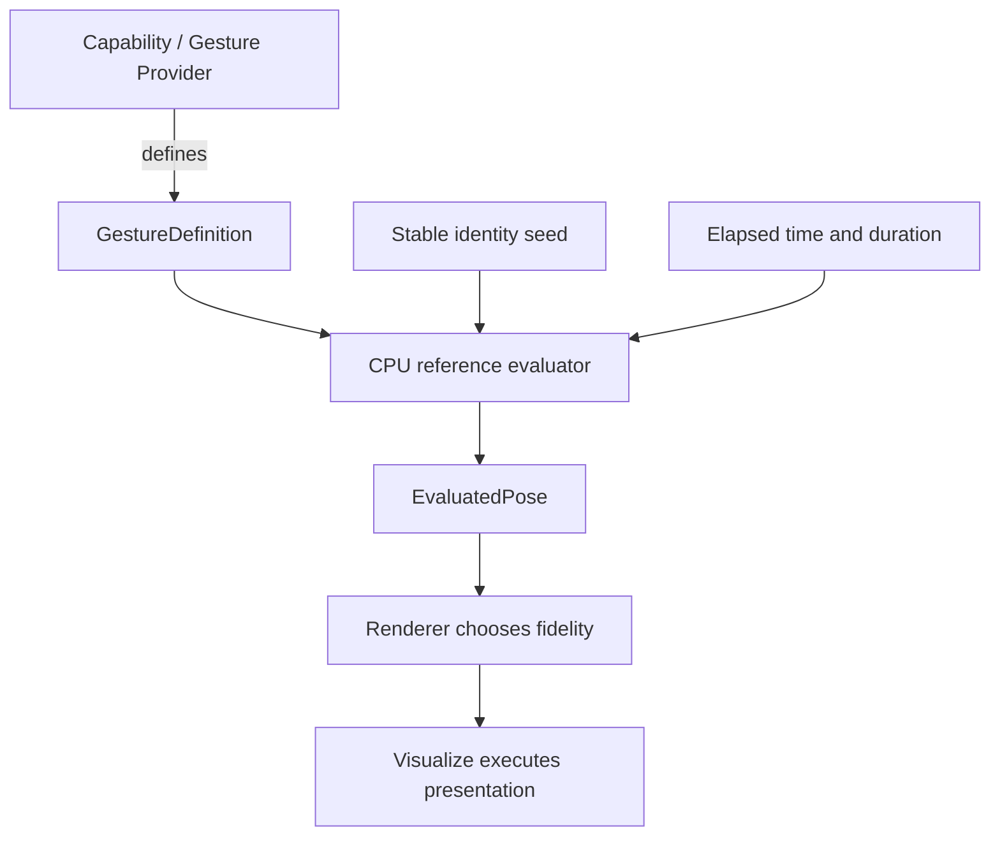
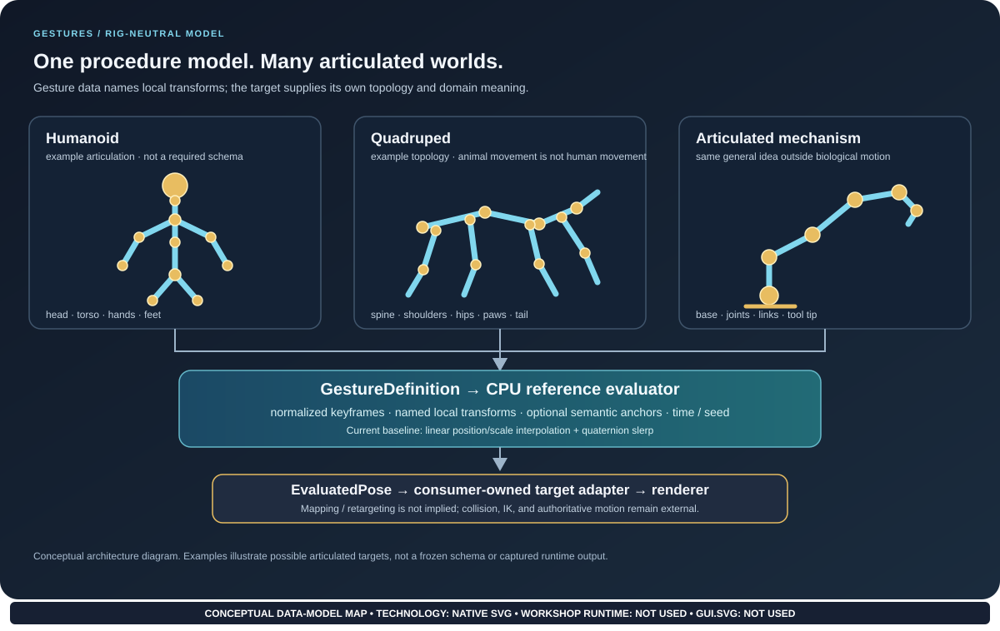

# Architecture

## The contract

A Gesture is a reusable description of a physical procedure. It supplies ideal local poses over normalized progression and may declare semantic anchors that let a provider explain where interaction occurs. It does not, by itself, move an entity through the authoritative world, resolve collisions, decide whether an interaction is permitted, or decide whether the procedure has completed successfully.

## Articulated targets: current support and open contract

The current keyframe model maps stable transform names to local `PoseTransform` values. It does not prescribe a humanoid bone list, so the data shape can represent humanoids, quadrupeds, birds, segmented bodies, turrets, and articulated mechanisms. “Gait” is a locomotion-specific concept; Gestures covers the broader space of physical procedures. That flexibility is not the same as automatic target compatibility: this repository has not yet frozen a hierarchy descriptor, naming/semantic-tag rules, target mapping, or retargeting contract.

The illustrated topologies are examples, not standardized schemas. A consumer or future articulated-target adapter must define how names map to its actual hierarchy. Evaluated local transforms do not imply inverse kinematics, collision solving, world-space reachability, or authoritative locomotion. Missing-transform behavior is described in the current data model and should not be interpreted as deleting a target joint.

## Responsibilities by package

| Component | Owns | Does not own |
| --- | --- | --- |
| Gestures | Gesture data, anchors, deterministic reference evaluation | Game rules, collision authority, renderer selection, GPU resources |
| FSM_API / behavior | State progression, interruptions, domain transitions | GPU presentation |
| Gesture Provider / MicroBundle | Domain-specific physical procedure and interaction anchors | Global rendering policy |
| Renderer | Observer-relative representation and fidelity | Authoritative world state |
| Visualize | GPU-facing presentation and pixels | Meaning of a Gesture or game-world authority |
| Host application | Input, window/surface lifecycle, composition | Gesture semantics by default |

## Initial model

- **GestureDefinition**: stable ID, ordered keyframes, optional anchors.
- **GestureKeyframe**: normalized time and a named map of local transforms.
- **PoseTransform**: position, rotation, and scale represented with System.Numerics.
- **GestureAnchor**: semantic point relative to a provider-owned transform.
- **GestureVariation**: explicit bounds for deterministic per-identity variation.
- **EvaluatedPose**: output for a single instant, exposed through read-only interfaces.

The initial evaluator linearly interpolates translation and scale and uses quaternion spherical interpolation for rotation. It clamps normalized progress, applies deterministic speed variation, and reports a separate bounded root offset. This is a reference baseline, not a final high-fidelity motion solver.

## Why a CPU reference comes first

An optimized evaluator cannot be trusted merely because it looks plausible in one scene. A deterministic CPU reference gives us known inputs and expected outputs for validating future GPU compute results, comparing backend layouts, testing interpolation and bounded variation, and identifying semantic mismatches before profiling throughput.

Floating-point GPU implementations may require explicit tolerances. Those tolerances should be documented per backend, not hidden by changing the reference evaluator's meaning.

## Evolution rules

1. Preserve semantic independence from Visualize, Renderer, WPF, Unity, and GPU APIs.
2. Keep authoritative movement and collision handling outside evaluated presentation output.
3. Make data contracts explicit and versionable before freezing binary/GPU layouts.
4. Benchmark populations and memory access before selecting packed textures or structure buffers.
5. Add complexity only when a real Gesture or consumer needs it.
