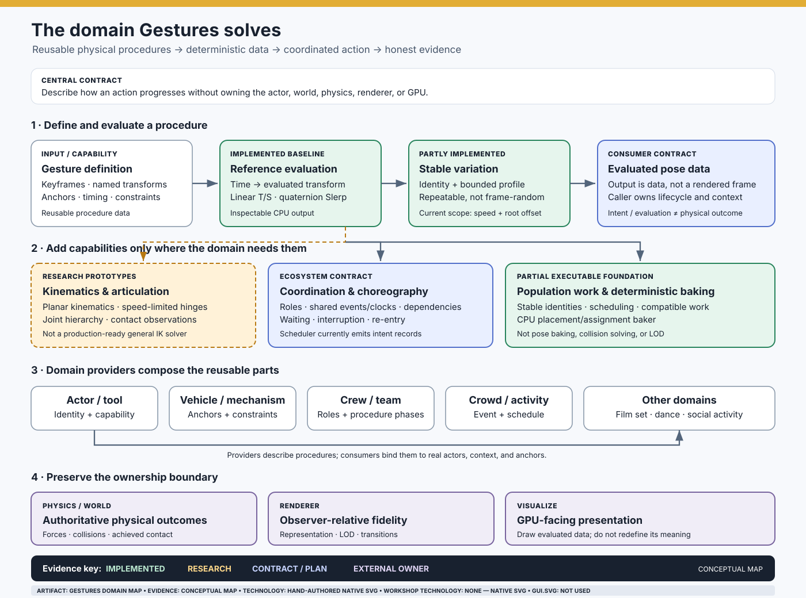

# The domain Gestures solves

> **Purpose:** make physical procedures reusable, deterministic, inspectable data—then show the reader what the data means through living, evidence-labelled documentation.

**Read the map correctly:** it is a conceptual domain map, not a runtime trace. Its labels distinguish the reference behavior already implemented, test-backed research prototypes, ecosystem contracts, and future work. The diagram is authored as native SVG; **GUI.SVG is not used**. See [SVG provenance and technology labels](SVG_PROVENANCE_STANDARD.md).

## The central problem

Many systems need an entity to perform a physical procedure: a person boards a vehicle, a crew member closes a hatch, a tool operates a mechanism, a soldier reacts to an order, or several participants coordinate around a shared event.

Gestures models the *procedure* separately from the entity, world, and presentation:

- **What should happen:** a reusable, versioned motion/procedure definition, with keyframes, named transforms, anchors, timing, and optional constraints.
- **How it is evaluated:** sample the procedure at a declared time and identity; return data that a consumer can inspect or present.
- **How individuals differ:** derive stable, bounded variation from identity and context, not fresh random noise on every frame.
- **How actions relate:** compose phases, roles, prerequisites, synchronization cues, interruptions, and observations where the application requires them.
- **How large workloads scale:** identify compatible work that can share inputs, scheduling, or execution while preserving each participant's identity and result.
- **What actually happened:** keep intended motion distinct from physical outcome, contact, completion, and observed success.

A Gesture is therefore neither just a baked animation clip nor a physics solver. It is a reusable description of a physical procedure and the data-evaluation capabilities around it.

## Capability map and evidence boundaries

| Domain | Responsibility | Current evidence / boundary |
|---|---|---|
| Procedure data and reference evaluation | Sample named transform keyframes over normalized progress; interpolate translation and scale linearly and rotation with quaternion spherical interpolation | **Implemented reference baseline.** See [Living Motion Documentation](LIVING_MOTION_DOCUMENTATION.md) and the generated [motion trajectory](assets/gesture-motion.svg). |
| Provider offers and actor-relative filtering | Compare declared actor-capability and semantic-anchor requirements against caller-supplied context; return deterministic eligible candidates and explicit missing-requirement reasons | **Implemented and test-backed.** `GestureOfferSelector` filters but does not rank by intent, resolve anchor transforms, or choose for the actor. See [provider-offer selection](GESTURE_OFFER_SELECTION.md). |
| Motion channels and identity | Expose evaluated channels and stable, bounded variation | **Partly implemented.** The experience-profile sampler currently bounds speed and root lateral offset; it does not yet model joint-level competence. See [variation scene generator](../tools/variation-demo/README.md). |
| Lifecycle and progression | Define evaluation time boundaries and explicitly coordinate one gesture's start, pause/resume, completion, and cancellation | **Implemented coordinator foundation.** `GesturePlayback` owns one caller-driven session; `GestureSequencePlayback` runs a fixed ordered sequence and transfers leftover time across boundaries. Looping, reversal, blending, branching, anchor resolution, and prerequisite evaluation remain absent. See [lifecycle contract](GESTURE_EVALUATION_LIFECYCLE.md). |
| Kinematics and articulated motion | Solve constrained movement through joints, hinges, and hierarchies | **Research prototypes.** Planar kinematics, speed-limited hinges, and stateful joint hierarchies are experiments, not a production-ready general IK solver. |
| Contact, failure, and recovery | Consume contact observations and choose recovery policy without confusing intent with achieved movement | **Research prototypes / boundary.** Physics or the consuming world remains authoritative for forces, collisions, and outcomes. |
| Experience ontology and fluent authoring | Classify reusable activities, define phases and roles, and propose validated runtime patches against versioned sessions | **Initial builder implemented and test-backed; runtime coordination planned.** `ExperienceDefinitionBuilder` creates immutable versioned definitions with classifications, phases, role bounds, and Gesture references. An optimistic `ExperienceDefinitionPatch` proposal now checks expected-version compatibility, but a general session coordinator and atomic patch engine are not implemented. See [experience ontology and fluent authoring](EXPERIENCE_ONTOLOGY_AND_FLUENT_AUTHORING.md). |
| Multi-participant coordination | Assign participants to roles, coordinate shared events/clocks, sequence prerequisites, and represent waiting or blocked work | **Ecosystem contract plus specific primitives.** The crowd-response scheduler produces deterministic intent records; it does not execute completed motion. See [multi-participant choreography](MULTI_PARTICIPANT_CHOREOGRAPHY.md). |
| Population execution and baking | Reuse compatible inputs, schedule update cadence, preserve stable identities, and produce compact representation-neutral data | **Partial executable foundation plus planned work.** Extremus has a CPU reference baker for deterministic placement/assignment records; it does not bake poses or solve navigation, collisions, or LOD. |
| Domain procedures | Compose reusable motion into soldier, vehicle, starport crew, tool, film-set, crowd, dance, and other procedures | **Consumer/provider territory.** These are examples of the breadth the abstractions should support, not a claim that every provider or scene exists today. |
| Realization and physical truth | Resolve world anchors, physical outcomes, observer-relative fidelity, and GPU presentation | **Explicit ownership boundary.** Physics owns authoritative physical outcomes; Renderer chooses observer-relative representation/fidelity; Visualize presents it. Gestures must not claim those responsibilities. |

## A procedure from intent to evidence

1. **Acquire capability.** A consumer discovers which procedures a provider offers. A provider can describe actions without embedding the actor, vehicle, or game engine into the core package.
2. **Filter for the actor and situation.** The consumer uses role, identity, available anchors, capability, and current state to narrow the available procedures. Selection policy belongs to the consumer/domain; a demo fixture must not be mistaken for the runtime.
3. **Bind the environment.** The consumer supplies valid anchors, constraints, timing, and context. Gestures should not invent world geometry or authoritative contact.
4. **Evaluate deterministically.** A declared time and stable identity produce inspectable output. Variation remains bounded and reproducible.
5. **Coordinate when needed.** A multi-participant activity adds roles, dependencies, shared timing, and interruption/re-entry rules; simple gestures need not pay for a coordinator.
6. **Realize through the correct owner.** The consumer may pass evaluated data to a presentation system. Physics decides physical outcomes; Renderer selects fidelity; Visualize draws.
7. **Observe and verify.** Record whether the requested procedure was merely scheduled, evaluated, presented, or physically achieved. These are different claims.

## The contract that keeps the domain reusable

- **Engine-neutral core:** no Unity, WPF, Renderer, GPU API, or game-specific types in the core contract.
- **Data before presentation:** a procedure and its evaluated result are inspectable without requiring a particular renderer.
- **Determinism before optimization:** batching or GPU evaluation must preserve stable identity and output semantics; it is not a license to change behavior.
- **Intent is not outcome:** a scheduled response is not completed movement; a pose is not contact; a path is not collision resolution.
- **No universal coordinator by default:** individual procedures, multi-person choreography, and population workloads are related but distinct capabilities.
- **Evidence follows the artifact:** generated SVGs must be traceable to the real implementation and fixture inputs. Conceptual images must say they are conceptual. Native SVG is not GUI.SVG usage.

## Living-documentation rule

Each important concept should have the most truthful visual proof available:

1. **Executable evidence first:** generate the image from real implementation output where that output exists, and make CI regenerate/validate it.
2. **Conceptual map when implementation is absent:** illustrate the relationship and label it as a proposal or research model.
3. **Expose the inputs and boundaries:** stable IDs, units, timebase, sample count, algorithm version, and excluded claims should be discoverable near the image.
4. **Prove only what the artifact can prove:** XML validation proves well-formedness; snapshot parity proves agreement with the generator; neither alone proves visual clarity or physical correctness.
5. **Name GUI.SVG honestly:** mark it `USED` only after the generator actually calls `TheSingularityWorkshop.GUI.SVG`. This map is currently native SVG and says `NOT USED`.

## Recommended next proof surfaces

- A provider → actor filtering → selected procedure example generated from real provider contracts, clearly distinguishing any standalone fixture from runtime evidence.
- A kinematics/joint-limit comparison driven by the existing research-prototype output, with unreachable targets and failure states visible.
- A contact/recovery timeline that separates requested motion, observed contact, policy decision, and authoritative physical outcome.
- A multi-participant choreography view showing roles, dependencies, shared clock, waiting/blocked states, and observed completion—not just figures arranged in a scene.
- A population work/cadence view backed by actual scheduler/baker outputs, explicitly separating intent schedules, deterministic placement, pose evaluation, and renderer LOD.

These are a proof backlog, not claims that all five surfaces already exist. Prefer extending a real generator and testing its output over hand-drawing a picture that looks more complete than the implementation.

---

**Domain summary:** Gestures owns reusable physical procedures and deterministic motion evaluation. It can grow coordination and population-execution capabilities where reusable primitives are justified. It does not own the world, physical truth, actor/game state, observer-relative rendering, or GPU presentation.
