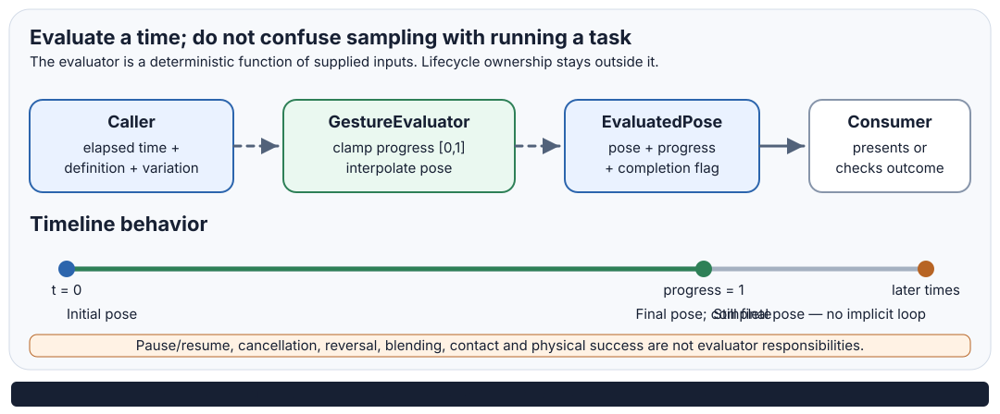

# Gesture Evaluation Lifecycle

## Scope

`GestureEvaluator.Evaluate` is a deterministic, stateless pose sampler. It evaluates a definition at a supplied elapsed time; it is not a running procedure, task scheduler, or owner of an entity's lifecycle.

This page records the behavior implemented by the current CPU reference evaluator. It deliberately does not freeze a future orchestration API.

## Inputs and timeline

- `definition` must be non-null.
- `elapsedSeconds` must be finite. Negative values are accepted and treated as zero.
- `durationSeconds` must be finite and strictly positive.
- The evaluator maps elapsed time to normalized progress, clamps progress to `[0, 1]`, and interpolates between adjacent normalized keyframes.
- With `GestureVariation.None`, progress is elapsed time divided by duration, clamped to the interval.
- With a nonzero speed deviation, a stable identity-seeded speed factor scales elapsed time before normalization. Completion therefore occurs when the *evaluated* progress reaches one; it is not guaranteed to occur at the unmodified duration boundary.
- A completed sample remains at the final keyframe for later elapsed times. There is no implicit wrap to the first keyframe.
- Position and scale are interpolated linearly; rotation uses the current `PoseTransform.Interpolate` behavior. This is a pose-sampling contract, not a claim about physically valid trajectories.

## Lifecycle ownership

The evaluator does not retain state between calls. The caller owns:

| Concern | Current contract |
| --- | --- |
| Start | Supply elapsed time zero to sample the initial pose. |
| Pause / resume | Preserve and resume the caller's elapsed-time clock. No pause state is stored by the evaluator. |
| Completion | Observe `EvaluatedPose.IsComplete`; it is true when normalized progress reaches one. |
| Looping | Not provided. A completed sample stays at the final pose. |
| Reverse playback | Not provided as a named operation. A caller may sample another timeline only if its own contract defines that meaning. |
| Interrupt / cancel | Not represented by the evaluator. The caller or procedure coordinator owns the handoff. |
| Blend / compose | Not provided. There is no implicit blending between definitions. |
| Physics outcome | Not inferred from a sampled pose. Contact, obstruction, grip, force, breakage, and world-state changes require authoritative host/physics observations. |

## Determinism and validation

For the same definition, elapsed time, duration, variation settings, identity seed, and supported runtime behavior, the evaluator is intended to return the same pose. Seeded variation is stable across calls; it is not regenerated as per-frame noise.

The evaluator rejects non-finite elapsed time and non-positive or non-finite duration. Definitions and transforms perform their own validation. The test suite pins negative-time behavior, timeline endpoints, completion clamping, invalid timing inputs, and fixed seeded reference vectors.

This does **not** yet promise bit-identical floating-point results across every CPU architecture/runtime, nor does it define serialization/version compatibility. Cross-runtime golden-vector tolerances and a versioned data format remain separate work.

## Verification boundary

The unit tests exercise the evaluator directly. The living SVG demos serialize sampled output into documentation; the SVG is evidence of those generated samples, not evidence that the browser runs the C# evaluator or that a physical rig follows the samples.

Before treating this as a full procedure lifecycle, the project still needs explicit coordinator semantics and tests for interruption, pause/resume integration, reversal policy, blending/ownership handoff, and provider-anchor resolution. These should be added as independently testable layers rather than making the evaluator stateful.
