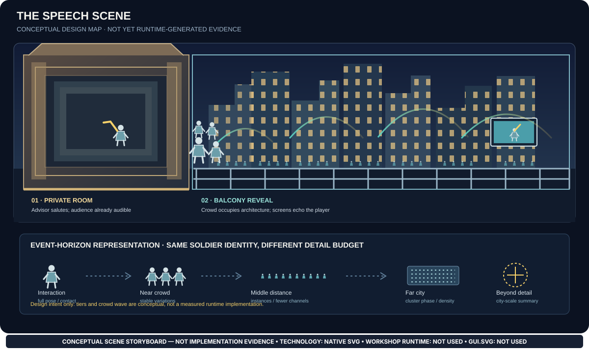
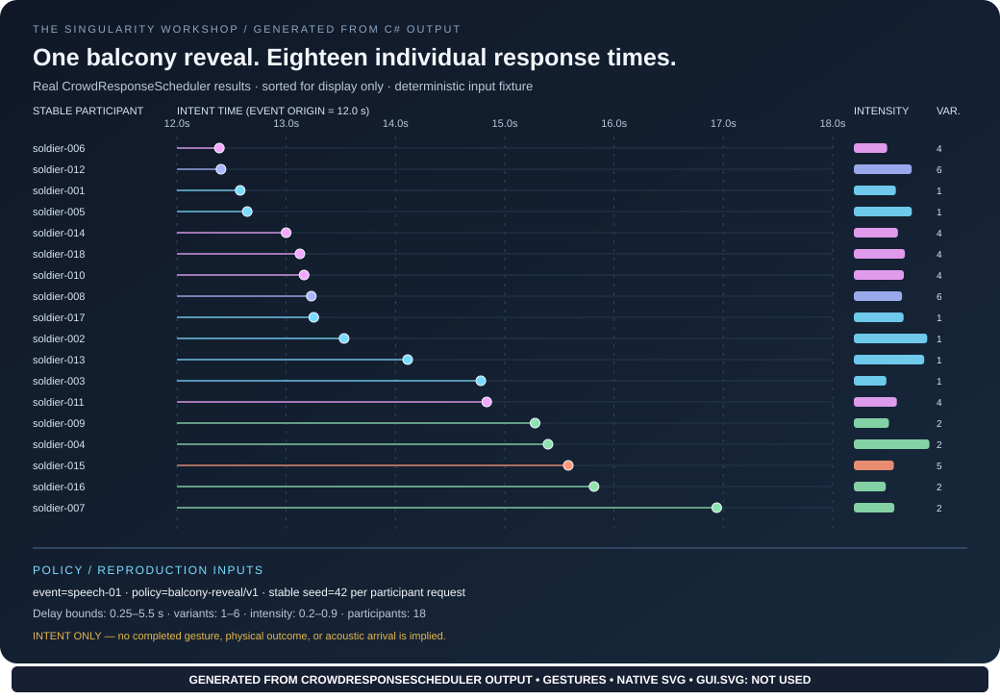
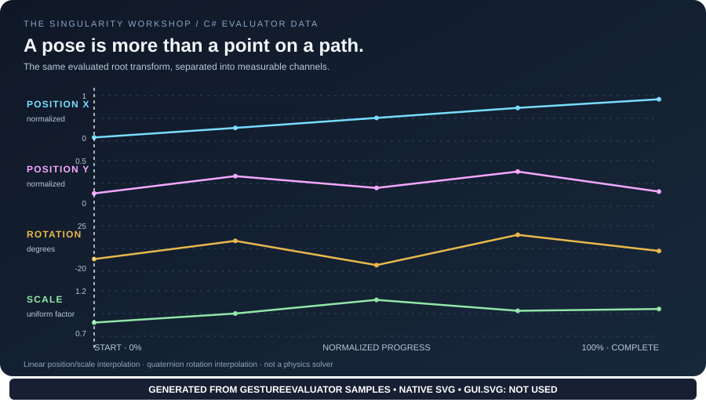
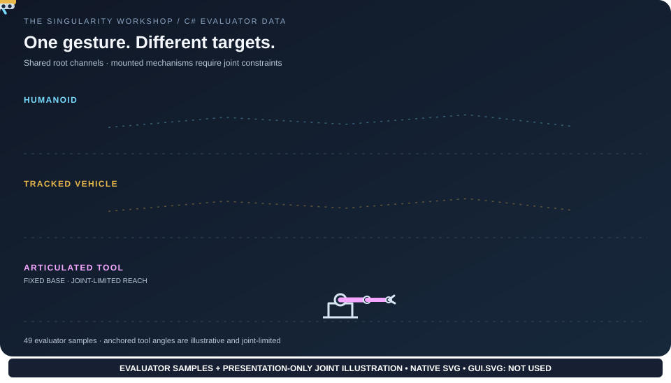

# Living motion documentation

Gestures teaches reusable animation principles. A gesture describes motion over time; it does not need to know whether its target is a soldier, tank, spaceship, tool, or abstract transform. The target's behavior and any physical simulation remain owned by their respective systems. Shared evaluation operations can later be batched across compatible targets, including on the GPU, without baking object-specific assumptions into Gestures. That batching is a future optimization, not a claim about the current CPU reference evaluator.

The documentation is part of the product experience: it should help readers *see* what the current implementation does, understand why the behavior matters, and follow the evidence back to real code.

## Concept scene: the speech and city-wide audience



The [Speech Scene and Soldier Population plan](SPEECH_SCENE_POPULATION.md) turns the moniker-to-balcony experience into explicit phases, ownership boundaries, gesture vocabulary, crowd-event timing, screen echo rules, and a staged validation plan. It is intentionally marked as a **conceptual design map**, not an evaluator-generated scene: the current SVG explains the target experience and the event-horizon idea; it does not prove that a crowd renderer, audio propagation model, articulated soldier, or city-scale simulation already exists.

The build workflow now parses this conceptual SVG as XML and includes it in the SVG whitespace check alongside the generated assets. This verifies document well-formedness and whitespace hygiene only; it does not validate the illustration's visual composition, execute its animation, or turn it into runtime evidence.

The scene contract also distinguishes physical sound from an attached sound-effect cue: Physics should derive impact/contact sounds from actual interactions and material state, while intentional crowd cheering is a vocal event whose sound is then propagated and mixed. Gestures describes the motion procedure; it must not fabricate physical contact or become a sound-effects system. See the [scene's sound ownership contract](SPEECH_SCENE_POPULATION.md#ownership-who-is-responsible-for-what).

For this scene, the documentation must fight for every soldier at the level of identity and behavior without requiring full CPU-side articulation for every distant silhouette. Close interactions can use richer gesture output; middle and far tiers can preserve stable identity and response phase through instanced representations and cluster summaries. Renderer owns observer-relative fidelity selection, Visualize owns GPU presentation, raWWar owns soldier/game state, and Physics owns physical outcomes. Those are design contracts to implement and measure—not current performance claims.


## Extremus: deterministic extreme-distance populations

[Extremus crowd-baking contract](EXTREMUS_CROWD_BAKING.md) defines the next scale-oriented workstream: compose reusable source poses and implemented activities into reproducible population instances, then bake renderer-neutral representation data with explicit provenance. Its first proposed fixture is two starport population patches generated from different stable seeds.

This is a **design contract, not a current visual or performance claim**. The current crowd-response SVG demonstrates deterministic intent scheduling, not a population bake or completed motion. The Extremus slice must generate its own artifacts from executable C# inputs, show its seed/profile/source IDs, and pass replay, order-independence, bounds, exclusion, and snapshot-parity tests before the illustration is described as generated evidence.

Renderer owns observer-relative LOD and transitions; Visualize owns presentation; Physics/domain owns authoritative physical outcomes and constraints. Gestures must remain engine-neutral and must not claim that a distant impostor is an individually recoverable actor unless its manifest actually preserves that mapping.

## Generated crowd-response schedule



This SVG is generated by [the crowd-response demo](../tools/crowd-response-demo/Program.cs), which calls the actual CPU scheduler and serializes its returned intent timestamps, variants, and intensity values. Its participant identities, event time, seed, and policy bounds are explicit fixture inputs. Sorting by intent time is presentation-only. The diagram proves the scheduler can produce inspectable, deterministic intent records; it does **not** show completed gestures, physical movement, collisions, acoustic arrival, or population-scale performance. CI runs the generator, validates SVG XML, and fails if this crowd-response snapshot drifts from the scheduler's actual output. Other existing motion SVG snapshots still use the older review-warning policy.

## Current generated scenes

### 1. Named transform tracks


The C# demonstration creates one `GestureDefinition` with three named transforms and samples `GestureEvaluator.Evaluate` 49 times. These are generic transform targets chosen to make the motion principles visible; their names do not make this a vehicle, character, or tool behavior. FSM_API coordinates the demo lifecycle. The path geometry and animated marker position, rotation, and scale are serialized from those evaluated outputs. The five authored keyframe times are marked with outlined diamonds; smaller circles distinguish the evaluated samples between them. In this fixed 49-sample demonstration, indices 0, 12, 24, 36, and 48 coincide with the authored keyframes at normalized times 0, 0.25, 0.5, 0.75, and 1.

**What this demonstrates:** the distinction between authored keyframes and evaluated in-between samples, normalized progress, linear position interpolation, quaternion rotation interpolation, scale interpolation, and how evaluated data can feed presentation.

**What this does not demonstrate:** parent-child composition, an articulated rig, IK, collision response, physical force integration, or a vehicle/character physics model. The transform names are dictionary keys; the current evaluator does not infer a mechanical assembly from them.

### 2. Motion channels over time



The second scene uses the same 49 samples to plot root X, root Y, rotation, and scale against normalized progress. The moving cursor connects the time axis to all four plots. This helps a reader see that a transform is a collection of channels, not only a dot moving along a path.

**What this demonstrates:** the relationship between the sampled evaluator output and the visual presentation of individual transform properties.

**What this does not demonstrate:** force, acceleration, momentum, damping, contact, or a physical solver. Those values are not outputs of the current evaluator and must not be invented for an attractive diagram.

### 3. Root motion versus an anchored articulated mechanism



The humanoid and tracked-vehicle glyphs illustrate the evaluated root transform. The articulated-tool glyph deliberately uses a different contract: its base is fixed, its two links rotate around joints, and the illustrative angles are clamped to declared ranges. The angle values are derived from the evaluator's root rotation and scale channels solely to make constrained articulation visible.

**What this demonstrates:** a mounted mechanism should not be translated as if it were a free-moving object. Its motion is relative to an anchor and limited by its joint configuration. The graphic makes that physical distinction visible.

**What this does not demonstrate:** joint values emitted by `GestureEvaluator`, a solved forward/inverse-kinematics chain, measured link geometry, collision/contact, or a physical solver. The articulated angles are presentation-only derivations, not runtime outputs. A future physically meaningful scene must use actual target joint definitions and a tested kinematics contract.

## Deterministic variation: living scene generator added

`GestureEvaluator.Evaluate` accepts a `GestureVariation` and a stable `identitySeed`. The current variation contract has two bounded channels:

| Channel | Current behavior | Boundary |
|---|---|---|
| Speed | Multiplies elapsed-time progression by a seed-derived factor around 1 | Fractional deviation is finite and in `[0, 1)` |
| Lateral offset | Returns a seed-derived X offset separately in `EvaluatedPose.RootOffset` | Maximum absolute offset is finite and non-negative |

The seed is mixed deterministically; it is not a source of fresh per-frame randomness. Repeating the same definition, elapsed time, duration, variation bounds, and seed yields the same result. Different seeds can yield different speed and offset values. With `GestureVariation.None`, changing the seed does not change the evaluated pose. These guarantees are covered by `SameIdentityAndInputsProduceSameVariation`, `FixedInputsMatchDeterministicReferenceVectors`, `VariationStaysWithinConfiguredBounds`, `DifferentIdentitySeedsCanProduceDifferentMotionWithinTheSameDeclaredBounds`, and `ZeroVariationIsIndependentOfIdentitySeed` tests.

The offset is returned as separate presentation/root-offset data; the evaluator does not silently bake it into every named transform. This is not yet joint-level skill, an experience-profile system, or physical response. A future variation scene should visualize the actual evaluator outputs for a small fixed set of seeds, show the declared bounds, and distinguish seed-driven results from the ideal baseline. The dedicated generator now lives in [tools/variation-demo](../tools/variation-demo/README.md). It samples two explicitly authored demonstration profiles with fixed identity seeds, calls the real `GestureExperienceProfile.Sample` and `GestureEvaluator.Evaluate` methods at 81 time samples per profile, and serializes normalized progress plus the separate returned root offset into `docs/assets/gesture-variation.svg`. The profile values are illustrative—not calibrated skill data—and the scene does not imply joint-level competence. The generated file is uploaded as a CI artifact and XML-validated. Until the generated snapshot is committed and the workflow has passed, treat the generator as added but the checked-in visual as pending.

## The teaching loop: concept → action → evidence

Every topic should let a reader move from an explanation to observable behavior and then back to the implementation. The SVG is the demonstration surface, not an ornamental summary.

Use this sequence for each concept:

1. **Concept.** State the rule in plain language and explain why a developer should care.
2. **Action.** Show the rule changing something visible: a pose between keyframes, a deterministic variation, a state transition, or another behavior the implementation actually produces.
3. **Mechanism.** Label the input, state, constraint, or equation responsible for the observed result. Prefer a small companion plot or timeline when it reveals something the main scene hides.
4. **Evidence.** Identify the generator, real implementation, relevant sample count or test, and any assumptions used to map data into the scene.
5. **Boundary.** State what the picture does not prove. Keep conceptual overlays visibly distinct from values emitted by the runtime.
6. **Reproduction.** Provide the command and automated checks needed to regenerate and review the result.

A scene is successful when a reader can answer: *What am I seeing? Which real data caused it? Which rule explains it? What should I not infer from it?* If a picture cannot answer those questions, improve the model, the evidence, or the explanation before polishing the artwork.

## Scene contract

Every living scene added here should:

1. **Start from real data.** Prefer a C# executable using the package under demonstration. Use FSM_API only where it actually coordinates a lifecycle or process.
2. **Keep provenance visible.** State which implementation generated the output, how many samples were evaluated, and which assumptions shape the picture.
3. **Separate model from presentation.** SVG may animate serialized samples, but must not imply that the browser is executing C# or running the package.
4. **Teach one main idea at a time.** Pair motion with a graph, state timeline, comparison, or annotations only when that extra view helps explain the same behavior.
5. **Respect accessibility.** Provide a meaningful title and description, sufficient contrast, labels that do not rely on color alone where practical, and a static fallback for `prefers-reduced-motion`.
6. **Remain reproducible.** Generate all three scene SVGs in CI, validate their XML, upload the generated files as artifacts, and report any difference from checked-in snapshots. The drift report is temporarily non-blocking until the committed snapshots have been synchronized with the generator; keep whitespace checks as a separate diagnostic.
7. **State limits, not aspirations.** Do not portray a future solver, hierarchy, interaction, or physics law as implemented.

## Next scenes to build

These are priorities for future iterations, not claims about current functionality.

| Priority | Scene | Evidence required before drawing |
|---|---|---|
| 1 | Keyframes → interpolated transform | Real keyframe definitions and evaluator samples; show keyframes separately from intermediate samples |
| 2 | Deterministic individual variation | Generator added in `tools/variation-demo`; CI generates and XML-validates the SVG. Commit a generated snapshot and verify the workflow before treating the visual as complete. |
| 3 | Progress and lifecycle | Real FSM_API transitions plus evaluator progress/completion values, including interruption only if the actual state model supports it |
| 4 | Multiple transforms with actual hierarchy | A documented parent/child composition contract and a tested evaluator/adapter that resolves it; named dictionary keys alone are insufficient |
| 5 | Dynamic response to forces/contact | A real, tested motion model producing state updates from declared forces, environment, and contact inputs; never substitute a hand-authored slip or impact animation |
| 6 | Baked motion-model data | A reproducible offline bake, metadata for its assumptions/domain, runtime interpolation, and explicit handling of out-of-domain inputs |
| 7 | Snapshot-drift enforcement | The CI job currently reports drift in all three generated snapshots. Synchronize the committed SVGs from the generated artifact, then restore a failing `git diff --exit-code` gate and verify it with a successful workflow run. |

## Reuse and batching: operations, not object names

The long-term performance goal is to make detailed motion affordable at scale. Prefer grouping targets by compatible evaluation work, data layout, and fidelity—not by labels such as `tank` or `soldier`. Different kinds of targets may share interpolation or other motion kernels; targets of the same kind may still be running different behaviors. A GPU implementation should batch only work whose semantics and data contract are compatible, with the CPU reference evaluator remaining a correctness baseline.

This is an architectural direction, not current functionality: the present evaluator is a CPU reference implementation, and these SVGs do not demonstrate GPU execution or performance. A future performance scene should show measured work and output from an actual batch implementation, alongside correctness comparisons and the tested workload.

## Future physics scenes: causality, not labels

When a genuine motion-model implementation exists, a good demonstration should show one shared environmental event affecting several participants differently because their real model parameters and states differ. For example, a wave should not issue a “boat wobble” visual command. The wave/environment model should produce an interaction; each vessel model should compute its response; any collision or downstream effect should follow the implemented interaction contract.

Expensive calculations may be baked at development time when the assumptions and validity domain are declared. Runtime still needs to account for changing inputs such as speed, loading, orientation, damage, and disturbances. A precomputed table is evidence only inside the domain it was designed to cover.

## Regenerate and validate

From the repository root:

```bash
dotnet run --project tools/living-demo/living-demo.csproj --configuration Release -- --output docs/assets/gesture-motion.svg
python -c "import xml.etree.ElementTree as ET; [ET.parse(p) for p in ['docs/assets/gesture-motion.svg', 'docs/assets/gesture-channels.svg', 'docs/assets/gesture-target-agnostic.svg']]"
```

The C# generator writes all three scene SVGs. CI validates their XML, uploads the generated outputs as artifacts, and reports snapshot drift. This report is temporarily non-blocking because the checked-in SVGs do not yet match the generator output; restore a failing drift gate after synchronizing the snapshots. The browser only plays serialized results; it does not execute FSM_API or GestureEvaluator.
