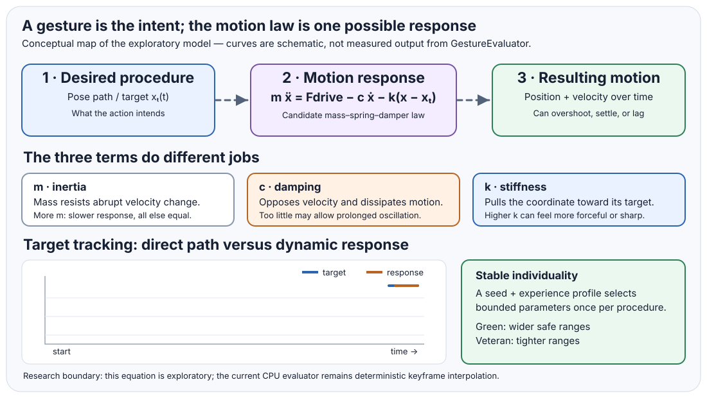

# Exploring the Motion Equation

> **Status: exploratory mathematics, not a frozen package contract.** This document records the physical intuition and a useful family of candidate models. It does not claim to reproduce the exact historical equation from memory. Preserve the original derivation and compare it against these formulations when available.
>
> For a structured comparison of kinematic easing, spring-damper tracking, meaningful parameterization, and a testable experiment matrix, see [Motion Model Experiment Plan](MOTION_MODEL_EXPERIMENT_PLAN.md).

## The idea: one ideal procedure, many believable performers

A Gesture can be viewed as a flipbook of poses plus a rule describing how motion progresses between them. The flipbook establishes the intended action. The motion equation determines how the body responds while moving toward the changing target.

Individualization belongs in the parameters of that rule—not in unrelated random offsets applied to finished frames. Each entity receives a stable seed. A training or experience profile maps that seed to bounded parameter variations around the ideal. The same inputs then reproduce the same individual motion, while a population avoids moving as thousands of exact copies.

## Start with Newton

Newton's second law gives the starting point:

\[
\mathbf{F} = m\mathbf{a}
\]

For a single coordinate \(x\), acceleration is the second derivative of position:

\[
m\ddot{x}=F
\]

This gives us inertia: motion does not instantly change merely because the desired position changes. A model based only on interpolating between two poses can describe a path, but it does not by itself describe the force and inertia that make the transition feel weighted.

For a rig, the same idea can be applied to selected joint coordinates or to translation and rotation components. Rotational motion has angular analogues—torque, moment of inertia, angular velocity, and angular acceleration. A production model need not pretend that every joint is a literal point mass; effective parameters can be chosen for the visual and behavioral response we want.

## Add spring-like restoring behavior and damping

A useful exploratory model is a driven mass-spring-damper:

\[
m\ddot{x}=F_{\text{drive}}(t)-c\dot{x}-k\bigl(x-x_{\text{target}}(t)\bigr)
\]

where:

- \(m\) is effective mass or inertia.
- \(F_{\text{drive}}\) is intentional drive from the procedure.
- \(c\) is damping, opposing velocity.
- \(k\) is stiffness, pulling the coordinate toward its target.
- \(x_{\text{target}}(t)\) is the coordinate prescribed by the pose path at the current phase.

This is a candidate family, not a claim that every Gesture should use a spring. If the restoring-force sign convention is written differently, the equivalent equation may appear on the other side of the equality. The important behavior is that inertia resists abrupt changes, the restoring term pulls toward the target, and damping controls overshoot and settling.

A related formulation uses the error \(e=x-x_{\text{target}}\). For a stationary target and no external drive, it reduces to the familiar homogeneous spring-damper response:

\[
m\ddot{e}+c\dot{e}+ke=0
\]

Its character depends on the relationship between mass, damping, and stiffness. Low damping can produce overshoot and oscillation; stronger damping suppresses it. Too much stiffness or an unstable numerical integration step can make the system unpleasant or numerically unstable. Those are parameters to reason about and test—not sliders to expose without constraints.

## Why ease-in and ease-out can emerge naturally

A hand-authored easing curve changes interpolation speed according to a selected mathematical profile. A dynamical model instead produces acceleration and deceleration as a consequence of inertia, drive, damping, and the target path.

That gives us a promising interpretation of weighted movement:

1. The procedure establishes the desired pose path.
2. Drive begins moving the body toward that path.
3. Inertia prevents instantaneous changes in velocity.
4. Damping limits overshoot and dissipates motion.
5. As the target or drive changes near the end of the transition, the response decelerates and settles.

This is not automatically superior to an easing curve. It is a different tool, with more expressive physical behavior and more parameters to calibrate. Some transitions may be best represented by direct interpolation; others may benefit from a dynamic response. Gestures should eventually make that choice explicit rather than silently imposing one universal motion law.

## Parameter ranges encode training

Define an ideal parameter vector for a Gesture:

\[
\boldsymbol{\theta}_0 =
(m_0,c_0,k_0,F_0,\ldots)
\]

An individual receives a stable seed \(s\) and an experience profile \(p\). The profile supplies per-parameter bounds or scales; a deterministic sampler maps \((s,p)\) to an individual parameter vector:

\[
\boldsymbol{\theta}_{i} =
\boldsymbol{\theta}_0+
\Delta\boldsymbol{\theta}(s_i,p)
\]

This additive form is illustrative only. Positive parameters such as mass, stiffness, and damping may be better varied multiplicatively or in a transformed space so sampling cannot produce invalid negative values. Parameters can also be correlated: changing stiffness without adjusting damping may produce a very different response than changing both coherently.

The crucial rule is that the seed selects one stable individual profile for the procedure. It must not resample the parameters every frame. Per-frame randomness creates jitter; seeded, bounded parameterization creates repeatable individuality.

### Green versus veteran: a simple teaching model

Let \(r_p\) be a dimensionless variation scale for experience profile \(p\). For each parameter, choose a safe range around its ideal value:

\[
\theta_i = \theta_0 + r_p\,\delta(s_i)
\]

where \(\delta(s_i)\) is a deterministic bounded sample, such as a value in \([-1,1]\). This simple expression is appropriate only for parameters where additive variation is safe; use positive-preserving mappings for physical parameters that must remain positive.

- **Green:** larger \(r_p\). Individual timing, amplitude, stiffness, and coordination can diverge more noticeably while remaining inside sensible bounds.
- **Veteran:** smaller \(r_p\). The same ideal procedure is performed with tighter variation, so the group appears more practiced and coordinated.
- **Still individual:** neither profile forces all soldiers to share one value. Veterans remain non-uniform; they simply cluster more tightly around the ideal.

Experience need not change every parameter in the same direction. A novice might have more timing variance and less consistent damping, while a veteran has tighter timing and more stable recovery. That is a design choice for each parameter family, not a single magic “skill” multiplier that should be applied blindly to all values.

## Apply it to marching

For marching, the ideal Gesture defines cyclic poses and phase: foot placement, weight transfer, leg swing, arm counter-swing, torso response, and recovery. The procedure provides the desired pose path and cadence.

A seeded soldier samples bounded values for such things as:

- cadence or phase offset;
- stride amplitude and timing;
- arm-swing amplitude;
- torso sway;
- effective response, damping, and settling;
- small coordination differences between linked body parts.

A green formation uses broader but valid ranges, producing a less synchronized population. A veteran formation uses narrower ranges, producing tighter coordination without becoming perfectly synchronized. These are illustrative controls: their actual set and safe ranges should be derived through experiments and visual review, not hard-coded as universal facts about human movement.

Variation should be coherent. For example, stride amplitude, cadence, and weight transfer should not be sampled independently if their combination makes a soldier appear to slide or lose balance. Parameter groups or constraints can preserve a sensible movement envelope.

## Determinism, numerical integration, and future GPU work

The motion model must be evaluated at a well-defined time or step. A future implementation should specify:

- whether the state is evaluated from absolute procedure time or advanced incrementally;
- the integration method and fixed-step policy, if it is stateful;
- how parameters and random samples are derived from stable identity and procedure context;
- valid bounds, unit conventions, and handling of degenerate cases;
- tolerances for CPU/GPU differences;
- reference test vectors for position, velocity, and pose output.

An incremental integrator can depend on step size and evaluation order. A pure absolute-time evaluator is easier to replay, but not every damped dynamic system has a convenient closed-form solution when its target is changing. We should compare the alternatives before committing the public API. Any GPU evaluator should be checked against a CPU reference with declared tolerances rather than assumed identical because it uses the same equation.

## Questions for experimentation

1. Which parts of the original motion equation were derived directly from \(F=ma\), and which were introduced as perceptual controls?
2. Is the spring attached to the target pose, a rest pose, or an intermediate desired trajectory?
3. Is easing an emergent result of the dynamics, a separate curve, or a selectable combination?
4. Which parameters are shared across a body, and which vary per joint or limb?
5. Which parameters should change with experience, fatigue, load, injury, equipment, or terrain?
6. Which constraints prevent mathematically valid values from producing physically implausible movement?
7. Should the reference evaluator be stateless in absolute time, fixed-step stateful, or support both modes?

## Recommended next experiment

Build a small visualization with one ideal marching cycle and a population of seeded soldiers. Expose the ideal parameters and the experience-dependent range scale. Render green and veteran groups side by side; allow the same seeds to be evaluated under both profiles. The result should make the concept visible: the underlying procedure stays the same, while the distribution of motion tightens with experience.

Record the equation, parameter values, timestep, and seeds for every comparison. This turns the exploration into a repeatable experiment instead of relying on memory or subjective impressions alone.

---

*The Singularity Workshop — edify, not mystify.*
