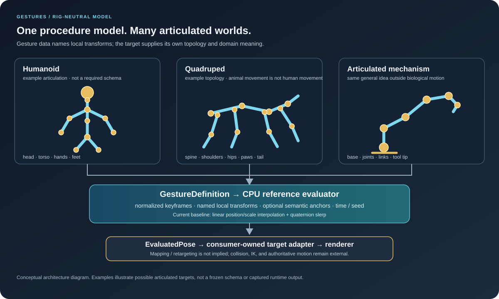

# Rig Contract Proposal (Draft)

> **Status: proposal, not a frozen public contract.** This document separates what the current implementation guarantees from the decisions that need real consumer examples before becoming API or serialization commitments.

## Purpose

A Gesture describes a physical procedure as normalized keyframes containing named local transforms, plus optional semantic anchors. It must not require a humanoid skeleton. Candidate consumers include humanoids, quadrupeds, birds, segmented creatures, and articulated mechanisms.

## What exists today

- Each keyframe contains an ordinal, case-sensitive map from a non-empty string name to a `PoseTransform`.
- A Gesture has at least two keyframes, starting at normalized time `0` and ending at `1`, with strictly increasing times.
- The evaluator interpolates values for named transforms; it does not currently require a declared parent/child hierarchy.
- Anchors have a semantic name, a parent-transform identifier, and a local transform. Anchor resolution against a concrete rig belongs to the consumer.
- The model uses `System.Numerics` and has no engine or renderer dependency.
- A transform absent from one keyframe is currently held from the endpoint where it exists. Absence is not a deletion command.

These guarantees allow many transform sets to be represented, but they do **not** mean any Gesture can automatically drive any target rig.

## Candidate ownership split

| Concern | Candidate owner | Reason |
| --- | --- | --- |
| Procedure intent, normalized keyframes, semantic anchor names | Gesture definition/provider | Domain-neutral reusable data |
| Actual rig hierarchy, bind/rest pose, target transform IDs | Rig descriptor or host-owned rig adapter | Different assets and domains have different topology |
| Mapping a Gesture transform name to a target rig transform | Consumer/adapter | Avoids guessing that names or topology are universally compatible |
| Anchor lookup and alignment to an interaction target | Provider + consumer adapter | Meaning is domain-specific; spatial resolution is target-specific |
| Reachability, IK, collision, balance, authoritative locomotion | Simulation/optional solver layer | These are not guaranteed by interpolation |
| Presentation fidelity and rendering | Renderer / presentation layer | Keep Gestures independent of rendering technology |

This split is a working hypothesis to test, not a new runtime API.

## Design principles to preserve

1. **No universal humanoid bone list.** Names such as `hips`, `left_hand`, or `tail_03` are examples, not required vocabulary.
2. **Stable identity before semantic convenience.** The current ordinal string keys are exact identifiers. If aliases, semantic tags, or standardized joint roles are added, their matching and conflict rules must be explicit.
3. **Local-space meaning must be explicit.** Current data is documented as local transforms, but the model does not yet carry a hierarchy with which to compute world transforms. Do not imply world-space guarantees.
4. **Missing data is not structural mutation.** The existing hold behavior must remain explicit. Removing a target joint or changing topology needs a separate, deliberate contract.
5. **Adapters are allowed; silent retargeting is not.** A consumer may map or convert data, but should be able to report missing, ambiguous, or incompatible targets.
6. **Optional capabilities stay optional.** IK, constraints, physics, retargeting, serialization, and GPU packing must not become hidden prerequisites of the base model.
7. **Examples must exercise different topologies.** At minimum, validate one humanoid and one non-humanoid rig; include a mechanism example to test the boundary between biological animation and general articulated procedures.

## Questions to settle with real consumers

- Is hierarchy metadata supplied by the target rig, declared alongside a Gesture, or split between both?
- Should names remain the only required transform identity, with optional semantic tags as hints?
- What are the exact validation outcomes for unknown names, duplicate/missing target transforms, and incompatible hierarchies?
- Should anchor `ParentJoint` be renamed to a rig-neutral term such as `ParentTransform` before public API stabilization? A vehicle hinge or tentacle segment need not be a joint in the skeletal-animation sense.
- Does a future rig descriptor need rest/bind transforms, units, handedness, or coordinate-system metadata, or should those stay in an adapter?
- How should consumers explicitly opt into retargeting, if it is ever added, and how will results be validated against reference poses?

## Next evidence required

Build small, named-transform examples for a humanoid, a quadruped, and an articulated mechanism. Record the mapping assumptions for each and test keyframe evaluation independently of rendering. Use those examples to answer the questions above before introducing a hierarchy type, semantic-tag API, serialized rig schema, or new dependencies.

## Non-goals

This proposal does not implement a skeleton system, animation graph, inverse kinematics, physics solver, collision avoidance, automatic retargeting, GPU evaluator, or a frozen cross-engine rig interchange format.
